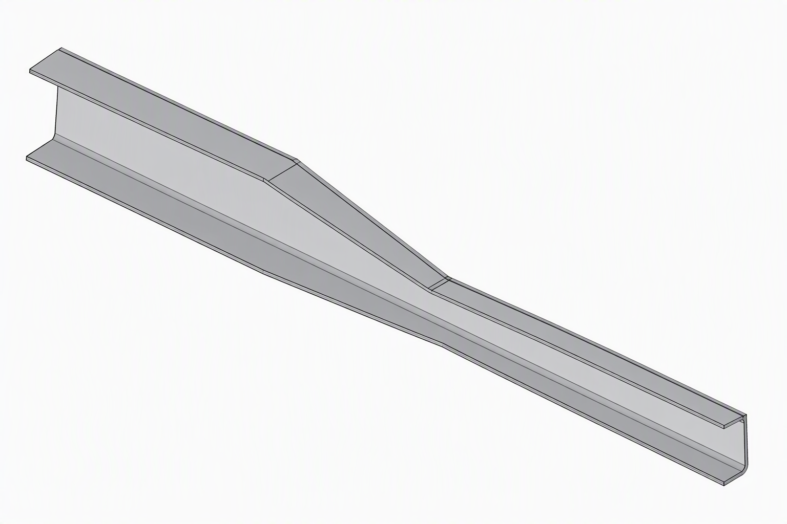
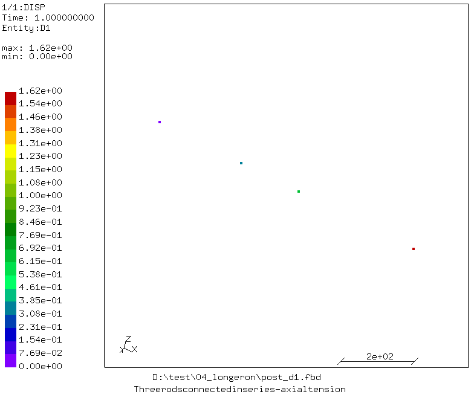
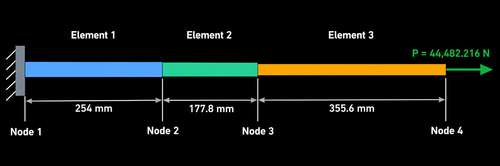

# Longeron (Two-node model)

## Purpose
Demonstration on how FEA calculates element stiffness matrices and solves for displacement and stresses. This is a useful example for understanding stiffness matrix assembly.

A longeron is idealized as 3 rods. Each individual rod has its own stiffness, but the three elements are connected through shared nodes. Assembly creates the global stiffness matrix, and applying the fixed boundary condition makes the system solvable.

The analytical solution provides a reference against which the CalculiX results can be validated.

Consider the following longeron:



The longeron consists of three sections: first section is has the highest height and a length of 254 mm with a cross-section area of 486.45 mm², then second section has a taper, where we will consider and average height corresponding to the centre of the section, has a length of 177.8 mm and a cross-section area of 357.42 mm² and a third section which is the longest and has shortest height, has length of 355.6 mm with a cross-section area of 228.39 mm².

## Platform
Software: Tested with cgx 2.23/ccx 2.23\
OS: Windows 11 and Ubuntu 26.04 on WSL2 (Windows 11)

## Contents

File                                             | Contents    
:-------------                                   | :-------------
[longeron_rod.fbd](longeron_rod.fbd)             | Pre-processing script for CGX for generating heatsink and its mesh     
[longeron_rod.inp](longeron_rod.inp)             | CCX input for the simulation
[post_d1.fbd](post_d1.fbd)                       | Post-processing script for CGX (contour plot of displacement in x-direction)
[post_Sxx.fbd](post_Sxx.fbd)                     | Post-processing script for CGX (contour plot of stress in x-direction)
[run_windows.bat](run_windows.bat)               | Run all commands to solve and view the simulations' results on windows
[run_linux.sh](run_linux.sh)                     | Run all commands to solve and view the simulations' results on linux
[run.py](run.py)                                 | Run all commands to solve and view the simulations' results on any platform

## Preprocessing
Two-node 3D truss elements (T3D2) with a single element for a section are used for the analysis.

Boundary conditions:
* Left end fixed: ux = 0 mm

Besides that displacement ix y and z directions are fixed for each node in order to strictly model a 1D line element by using the axial displacement.

Loading:
* A force of 44,482.22 N is applied to the right end of the longeron

### Generating mesh and node sets

```bash
cgx -b longeron_rod.fbd
```

## Solving
```bash
ccx -i longeron_rod
```

## Postprocessing
```bash
cgx -b post_d1.fbd
```

This creates a contour plot of the axial displacement, showing only the four nodes of the model.



See that the right end of the longeron is displaced by 1.62 mm, the calculation of which is shown in the [section below](#finite-element-solution).

```bash
cgx -b post_Sxx.fbd
```

This creates a contour plot of the axial stress, showing only the four nodes of the model.

## Run complete project
To run the complete project on linux, run:
```bash
chmod +x run_linux.sh
./run_linux.sh
```

On windows, double click on "run_windows.bat", or open cmd, navigate to the directory and run:
```bash
run_windows.bat
```

Or if you have already installed this repository as mentioned in [README](https://github.com/mkhan138/calculix-fea-examples#getting-started), run:
```bash
run-example
```

## Finite Element Solution

### Problem definition
The model has three axial bar elements, four nodes, and one degree of freedom per node in the longitudinal X direction.



| Property | Element 1 | Element 2 | Element 3 |
|---|---:|---:|---:|
| Length (mm)           | 254     | 177.8  | 355.6 |
| Area (mm²)            | 486.450 | 357.42 | 228.39 | 
| Young's Modulus (MPa) | 71,015 | 71,015 | 71,015 |

### Element Stiffness Matrices

For a two-node axial bar element, the local stiffness matrix is:

$$
\boxed{
[k^{(e)}]=\frac{AE}{L}
\begin{bmatrix}
1 & -1\\
-1 & 1
\end{bmatrix}
}
$$

Where:
- $A$ = cross-sectional area (mm²)
- $E$ = Young's modulus (N/mm²)
- $L$ = element length (mm)

The resulting stiffness has units of N/mm.

#### Element 1

$$
k_1=\frac{A_1E}{L_1}
$$

$$
k_1=\frac{486.44464(71015.0)}{254}
$$

$$
k_1=136005.4\text{ N/mm}
$$

Therefore:

$$
[k^{(1)}]=
\begin{bmatrix}
136005.4 & -136005.4\\
-136005.4 & 136005.4
\end{bmatrix}
$$

#### Element 2

$$
k_2=\frac{A_2E}{L_2}
$$

$$
k_2=\frac{357.40064(71015.0)}{177.8}
$$

$$
k_2=142747.9\text{ N/mm}
$$

Therefore:

$$
[k^{(2)}]=
\begin{bmatrix}
142747.9 & -142747.9\\
-142747.9 & 142747.9
\end{bmatrix}
$$

#### Element 3

$$
k_3=\frac{A_3E}{L_3}
$$

$$
k_3=\frac{228.08664(71015.0)}{355.6}
$$

$$
k_3=45549.0\text{ N/mm}
$$

Therefore:

$$
[k^{(3)}]=
\begin{bmatrix}
45549.0 & -45549.0\\
-45549.0 & 45549.0
\end{bmatrix}
$$

### Assembly of the Global Stiffness Matrix

The model contains four nodes and three elements.

| Element | Local Node 1 | Local Node 2 |
|---|---:|---:|
| Element 1 | 1 | 2 |
| Element 2 | 2 | 3 |
| Element 3 | 3 | 4 |

Each element contributes its stiffness terms to the corresponding global node positions.

The global stiffness matrix is assembled as:

$$
[K]=
\begin{bmatrix}
k_1 & -k_1 & 0 & 0\\
-k_1 & k_1+k_2 & -k_2 & 0\\
0 & -k_2 & k_2+k_3 & -k_3\\
0 & 0 & -k_3 & k_3
\end{bmatrix}
$$

Substituting the calculated stiffness values:

$$
[K]=
\begin{bmatrix}
136005.4 & -136005.4 & 0 & 0\\
-136005.4 & 278753.3 & -142747.9 & 0\\
0 & -142747.9 & 188296.9 & -45549.0\\
0 & 0 & -45549.0 & 45549.0
\end{bmatrix}
$$

All matrix entries are in N/mm.

This is the assembled 4 × 4 global stiffness matrix before applying boundary conditions.

### Static Equilibrium Equation

The finite element equilibrium equation is:

$$
\boxed{[K]\{d\}=\{F\}}
$$

The nodal displacement vector is:

$$
\{d\}=
\begin{bmatrix}
d_1\\
d_2\\
d_3\\
d_4
\end{bmatrix}
$$

The external force vector is:

$$
\{F\}=
\begin{bmatrix}
0\\
0\\
0\\
44482.21615
\end{bmatrix}
$$

#### Apply Boundary Conditions

The left end is fixed:

$$
\boxed{d_1=0}
$$

The transverse degrees of freedom are constrained to zero, leaving only the longitudinal degrees of freedom.

Substituting $d_1=0$, we obtain the reduced system:

$$
\begin{bmatrix}
278753.3 & -142747.9 & 0\\
-142747.9 & 188296.9 & -45549.0\\
0 & -45549.0 & 45549.0
\end{bmatrix}
\begin{bmatrix}
d_2\\
d_3\\
d_4
\end{bmatrix}
=
\begin{bmatrix}
0\\
0\\
44482.21615
\end{bmatrix}
$$

This is the system of three simultaneous equations to be solved.

### Solve for Nodal Displacements

Expanding the matrix equation gives:

**Equation 1:**

$$
278753.3d_2-142747.9d_3=0
$$

**Equation 2:**

$$
-142747.9d_2+188296.9d_3-45549.0d_4=0
$$

**Equation 3:**

$$
-45549.0d_3+45549.0d_4=44482.21615
$$

Solving these simultaneous equations gives the nodal displacements.

The first displacement is known from the fixed boundary condition:

$$
d_1=0
$$

The remaining nodal displacements are:

$$
d_2\approx0.3271\text{ mm}
$$

$$
d_3\approx0.6387\text{ mm}
$$

$$
d_4\approx1.6152\text{ mm}
$$

### Final Nodal Displacement Results

The nodal displacement vector is:

$$
\boxed{
\{d\}=
\begin{bmatrix}
0\\
0.3271\\
0.6387\\
1.6152
\end{bmatrix}
\text{ mm}
}
$$

This result is similar of the Calculix mode as shown in [this](results/plot_d1.png) result.

| Node | X Coordinate (mm) | Displacement U1 (mm) |
|---|---:|---:|
| 1 | 0.0 | 0.000000 |
| 2 | 254.0 | 0.3271 |
| 3 | 431.8 | 0.6387 |
| 4 | 787.4 | 1.6152 |

### Verification: Substitute Displacements into Kd = F

Using the calculated displacement vector:

$$
\{d\}=
\begin{bmatrix}
0\\
0.3271\\
0.6387\\
1.6152
\end{bmatrix}
$$

Substitute into the assembled global stiffness matrix:

$$
[K]\{d\}=\{F\}
$$

The resulting force vector is approximately:

$$
\boxed{
\begin{bmatrix}
-44482.21615\\
0\\
0\\
44482.21615
\end{bmatrix}
\text{ N}
}
$$

The first entry is the reaction force at the fixed support. Its negative sign indicates that it acts opposite to the applied tensile load.

Therefore:

- Reaction at Node 1 = -44,482.21615 N.
- Applied force at Node 4 = +44,482.21615 N.
- Net external force = 0 N.

**Equilibrium is satisfied.**

### Additional Results: Element Elongations and Stresses

The elongation of each element is the difference between its two nodal displacements:

$$
\Delta L_e=d_j-d_i
$$

The axial strain is:

$$
\epsilon_e=\frac{\Delta L_e}{L_e}
$$

The axial stress is:

$$
\sigma_e=E\epsilon_e
$$

The axial force is:

$$
N_e=A_e\sigma_e
$$

Results:

| Element | Elongation (mm) | Axial Force (N) | Axial Stress (MPa) |
|---|---:|---:|---:|
| 1 | 0.3271 | 44,482.216 | 91.440 |
| 2 | 0.3116 | 44,482.216 | 124.456 |
| 3 | 0.9753 | 44,482.216 | 194.765 |

All three elements carry the same axial force because they are connected in series and there are no intermediate external loads. This result also matches with the Calculix result as shown [above](results/plot_Sxx.png).

### Comparison with CalculiX

When running the CCX model, inspect the displacement results in CGX.

Expected results:

| Node | Analytical U1 (mm) | Expected CCX U1 (mm) |
|---|---:|---:|
| 1 | 0.000000 | 0.000000 |
| 2 | 0.3271 | 0.3271 |
| 3 | 0.6387 | 0.6387 |
| 4 | 1.6152 | 1.6152 |

Small differences can occur due to numerical precision.

### Complete Analytical Solution Summary

#### Final FEM Results

| Parameter | Value |
|---|---:|
| Total length | 787.4 mm |
| Applied load | 44,482.21615 N |
| Number of elements | 3 |
| Number of nodes | 4 |
| Material Young's modulus | 71,015 MPa |

#### Nodal Displacement Vector

$$
\boxed{
\{d\}=
\begin{bmatrix}
0\\
0.3271\\
0.6387\\
1.6152
\end{bmatrix}
\text{ mm}
}
$$

#### Maximum Displacement

$$
\boxed{
U_{\max}=1.6152\text{ mm}
}
$$

Location: Node 4, in the positive X direction.