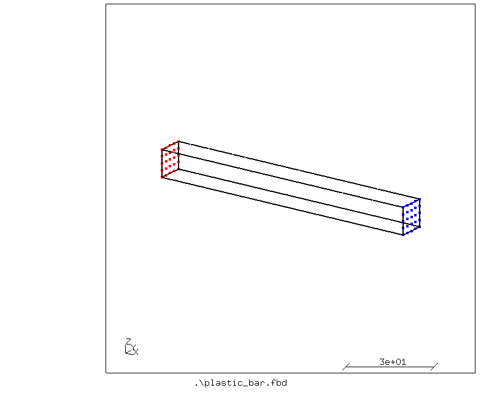
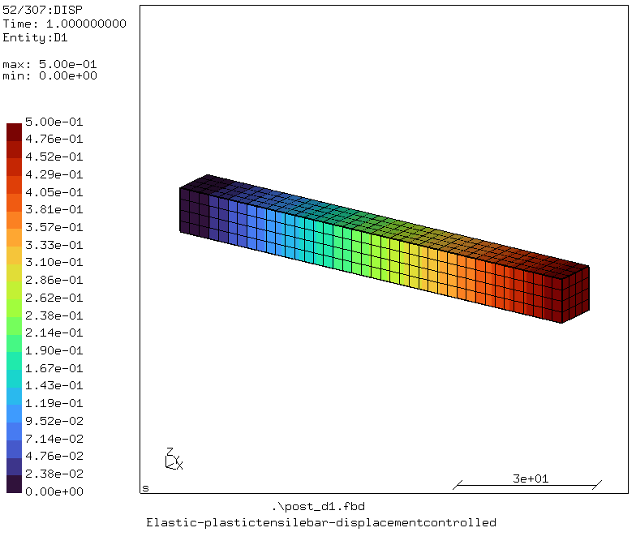
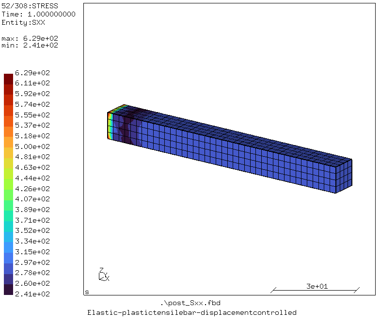
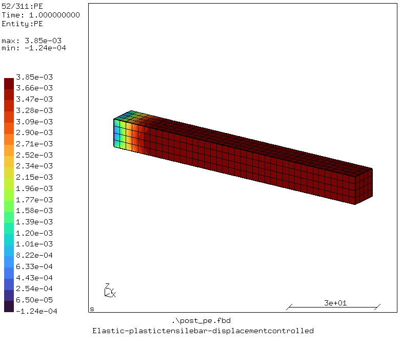
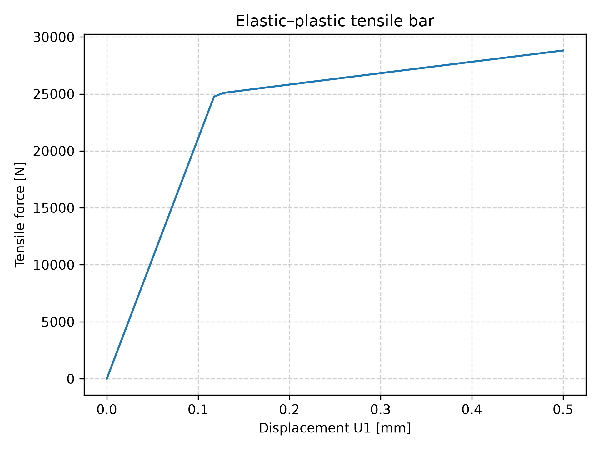

# Elastic-plastic Bar

## Purpose
Demonstration of nonlinear static analysis of an elastic-plastic tensile bar fully fixed at one end.

A tensile bar displaced at its free end is analyzed. The bar is 100 x 10 x 10 mm<sup>3</sup>, which is displaced 0.5 mm at its right end and is completely fixed in all directions on the left end. See [analytical solution](reference/analytical_solution_plastic_bar.ipynb) for the analytical solution.



The nodes in red show the fixed end of the beam where it is fixed in all directions and the free end is shown in blue where it is displaced in positive x direction.

## Platform
Software: Tested with cgx 2.23/ccx 2.23\
OS: Windows 11 and Ubuntu 26.04 on WSL2 (Windows 11)

## Contents

File                                       | Contents    
:-------------                             | :-------------
[plastic_bar.fbd](plastic_bar.fbd)         | Pre-processing script for CGX for generating tensile bar and its mesh     
[plastic_bar.inp](plastic_bar.inp)         | CCX input for the simulation
[post_d1.fbd](post_d1.fbd)                 | Post-processing script for CGX (contour plot of displacement in x direction)
[post_Sxx.fbd](post_Sxx.fbd)               | Post-processing script for CGX (contour plot of Sxx)
[post_pe.fbd](post_pe.fbd)                 | Post-processing script for CGX (contour plot of equivalent plastic strain)
[run_windows.bat](run_windows.bat)         | Run all commands to solve and view the simulations' results on windows
[run_linux.sh](run_linux.sh)               | Run all commands to solve and view the simulations' results on linux
[run.py](run.py)                           | Run all commands to solve and view the simulations' results on any platform

## Preprocessing
Elements of first order hexahedral (brick) elements (C3D8) are used for the analysis.

Boundary conditions:
* Left end fixed in all directions: ux = uy = uz = 0 mm

Loading:
* Displacement applied on the right end with 0.5 mm

### Generating mesh and node sets

```
> cgx -b plastic_bar.fbd
```

## Solving
```
> ccx -i plastic_bar
```

## Postprocessing
```
> cgx -b post_d1.fbd
```

This creates a contour plot of the displacement in x direction. 



This figure shows the displacement as applied in x direction.

```
> cgx -b post_Sxx.fbd
```

This creates a contour plot of the axial stress.



The axial stress near the free end of the beam is almost the same as mentioned in [analytical solution](reference/analytical_solution_plastic_bar.ipynb).

```
> cgx -b post_pe.fbd
```

This creates a contour plot of the equivalent plastic strain which is nearly the same as mentioned in [analytical solution](reference/analytical_solution_plastic_bar.ipynb)..



```
> python plot_force_displacement.py
```

This creates the force versus displacement plot.



The initial elastic response is linear. Yield starts at 0.11905 mm and F = 25000 N as mentioned in the analytical solution. Afterwards the force still increases, but with a much smaller slope due to plastic deformation and hardening.

## Run complete project
To run the complete project on linux, run:
```
> chmod +x run_linux.sh
> ./run_linux.sh
```

On windows, double click on "run_windows.bat", or open cmd, navigate to the directory and run:
```
> run_windows.bat
```

Or if you have already installed this repository as mentioned in [README](https://github.com/mkhan138/calculix-fea-examples#getting-started), run:
```
> run-example
```