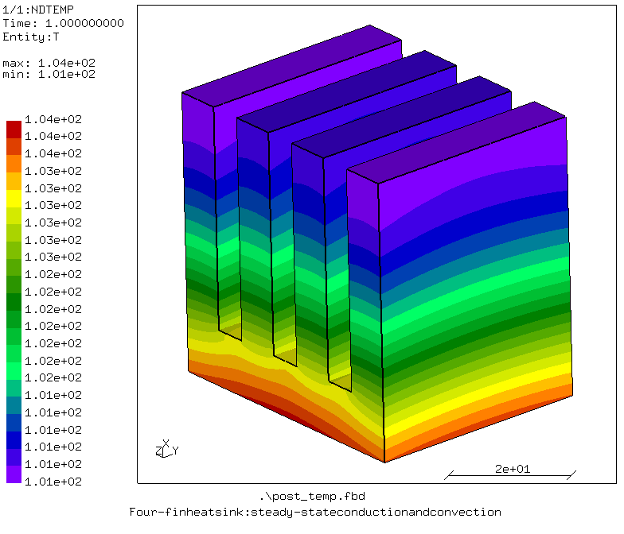

# Heatsink

## Purpose
Demonstration of steady state heat transfer analysis of a heatsink.

The geometry and surfaces for loadings are shown in the figure below.


The heatsink has four fins which are 8mm width, 40 mm height and 40 mm width, and the base of the heatsink is 10 mm. A power of 36,000 mW is applied to the bottom surface (18 mW/mm<sup>2</sup>) shown in red. A convection film coefficient of 0.023 mW/mm<sup>2</sup>K is applied on the green surfaces (other than the bottom).

## Platform
Software: Tested with cgx 2.23/ccx 2.23\
OS: Windows 11 and Ubuntu 26.04 on WSL2 (Windows 11)

## Contents

File                                                   | Contents    
:-------------                                         | :-------------
[heatsink_steadyState.fbd](heatsink_steadyState.fbd)   | Pre-processing script for CGX for generating heatsink and its mesh     
[heatsink_steadyState.inp](heatsink_steadyState.inp)   | CCX input for the simulation
[post_temp.fbd](post_temp.fbd)                         | Post-processing script for CGX (contour plot of temperature)
[run_windows.bat](run_windows.bat)                     | Run all commands to solve and view the simulations' results on windows
[run_linux.sh](run_linux.sh)                           | Run all commands to solve and view the simulations' results on linux
[run.py](run.py)                                       | Run all commands to solve and view the simulations' results on any platform

## Preprocessing
Elements of first order hexahedral (brick) elements (C3D8) are used for the analysis.

Loading:
* Surface flux of 18 mW/mm<sup>2</sup> is applied to the bottom surface
* Film condition with a coefficient of 0.023 mW/mm<sup>2</sup>K on the surfaces other than the bottom surface

### Generating mesh and node sets

```bash
cgx -b heatsink_steadyState.fbd
```

## Solving
```bash
ccx -i heatsink_steadyState
```

## Postprocessing
```bash
cgx -b post_temp.fbd
```

This creates a contour plot of the nodal temperature.



This steady state analysis shows the temperature distribution in the heatsink at the final equilibrium of the system. It can be seen that the base is the hottest, whereas the tip of the outer fins are the coolest.

## Run complete project
To run the complete project on linux, run:
```bash
chmod +x run_linux.sh
./run_linux.sh
```

On windows, double click on "run_windows.bat", or open cmd, navigate to the directory and run:
```bash
run_windows.bat
```

Or if you have already installed this repository as mentioned in [README](https://github.com/mkhan138/calculix-fea-examples#getting-started), run:
```bash
run-example
```