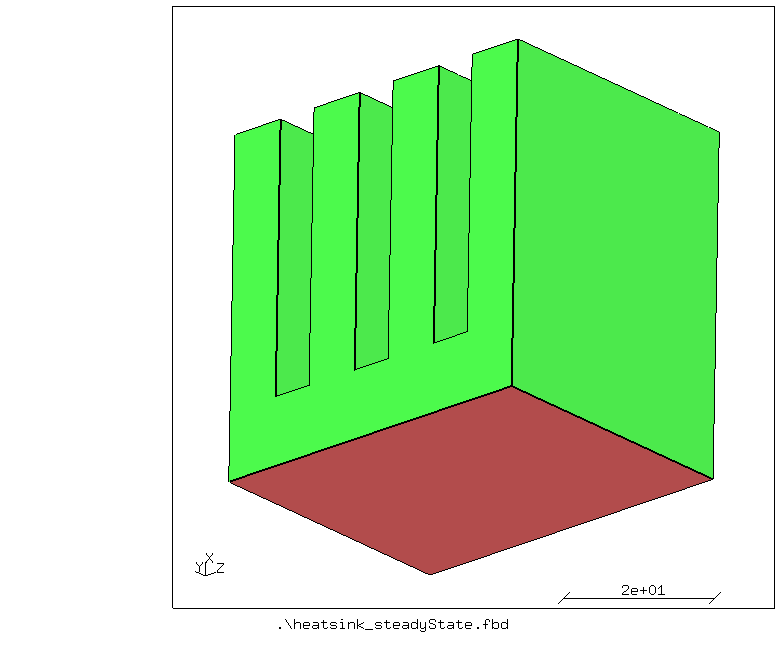
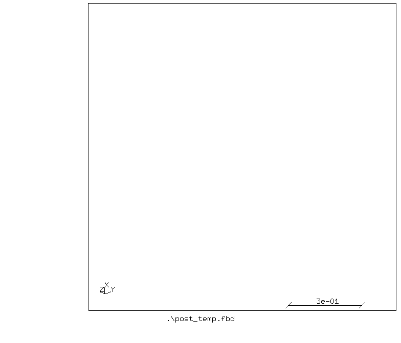
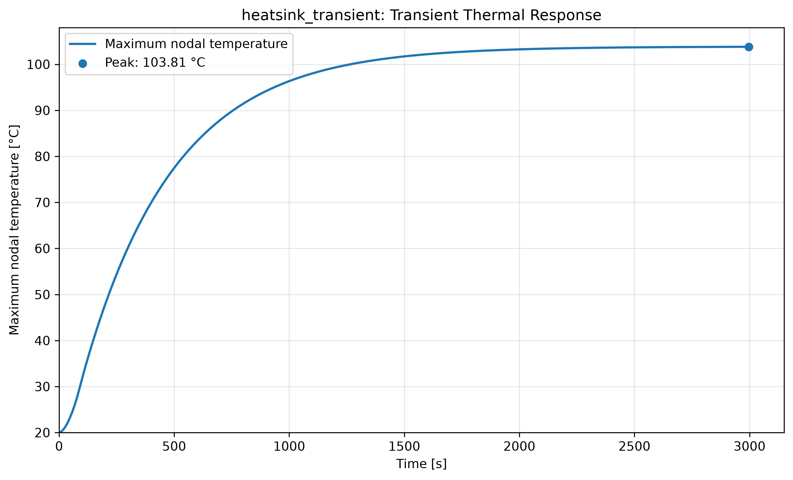

# Heatsink

## Purpose
Demonstration of transient heat transfer analysis of a heatsink.

The geometry and surfaces for loadings are shown in the figure below.



The heatsink has four fins which are 8mm width, 40 mm height and 40 mm width, and the base of the heatsink is 10 mm. A power of 36,000 mW is applied to the bottom surface (18 mW/mm<sup>2</sup>) shown in red. A convection film coefficient of 0.023 mW/mm<sup>2</sup>K is applied on the green surfaces (other than the bottom). The simulation is performed for 3000 seconds (50 minutes).

## Platform
Software: Tested with cgx 2.23/ccx 2.23\
OS: Windows 11 and Ubuntu 26.04 on WSL2 (Windows 11)

## Contents

File                                                   | Contents    
:-------------                                         | :-------------
[heatsink_transient.fbd](heatsink_transient.fbd)       | Pre-processing script for CGX for generating heatsink and its mesh     
[heatsink_transient.inp](heatsink_transient.inp)       | CCX input for the simulation
[post_temp.fbd](post_temp.fbd)                         | Post-processing script for CGX (gif of nodal temperaure)
[animate_ndtemp.fbl](animate_ndtemp.fbl)               | Post-processing script for CGX (commands for gif creation)
[run_windows.bat](run_windows.bat)                     | Run all commands to solve and view the simulations' results on windows
[run_linux.sh](run_linux.sh)                           | Run all commands to solve and view the simulations' results on linux
[run.py](run.py)                                       | Run all commands to solve and view the simulations' results on any platform

## Preprocessing
Elements of first order hexahedral (brick) elements (C3D8) are used for the analysis.

Loading:
* Surface flux of 18 mW/mm<sup>2</sup> is applied to the bottom surface
* Film condition with a coefficient of 0.023 mW/mm<sup>2</sup>K on the surfaces other than the bottom surface

Time:
* Performed for 3000 seconds.

### Generating mesh and node sets

```
> cgx -b heatsink_transient.fbd
```

## Solving
```
> ccx -i heatsink_transient
```

## Postprocessing
```
> cgx -b post_temp.fbd
```

This creates a gif of the nodal temperature.



This transient analysis shows the temperature distribution over time in the heatsink. It can be seen that the base is the hottest, whereas the tip of the outer fins are the coolest at the end of the simulation.

```
> python ..\..\..\scripts\plot_max_nd_temp.py heatsink_transient.frd
```

This creates a csv and png of the maximum nodal temperature over time.



## Run complete project
To run the complete project on linux, run:
```
> chmod +x run_linux.sh
> ./run_linux.sh
```

On windows, double click on "run_windows.bat", or open cmd, navigate to the directory and run:
```
> run_windows.bat
```

Using python3 on any platform:
```
> python run.py
```